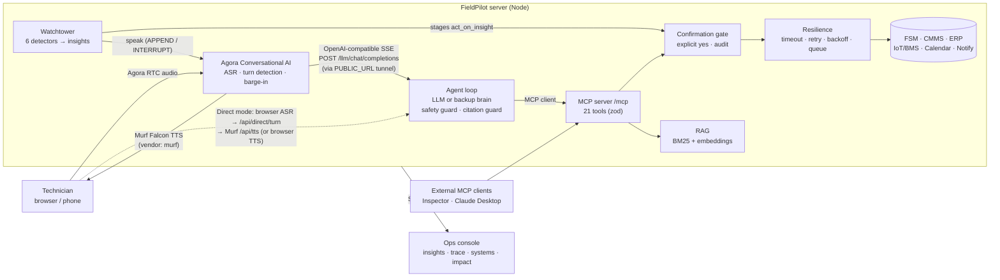

# FieldPilot: a voice copilot that speaks up first

**A field technician talks; FieldPilot works the job end to end, and notices problems before being asked.**
It briefs the day, diagnoses one question at a time from live telemetry, repair history and manuals (citing them aloud), refuses unsafe shortcuts, finds parts when the warehouse is out, and reads back every critical action before running it. It recovers from system failures out loud, closes the visit across five systems in one confirmed step, and writes the service report.
A background **Watchtower** watches every system and interrupts at the right moment with one evidence-backed offer.

Built with **Agora Conversational AI** (RTC, ASR, turn detection, barge-in) · **Murf AI Falcon** TTS · any OpenAI-compatible **LLM** with tool calling · **RAG** · **MCP** · Node + React.

---

## 60-second quickstart (no keys needed)

```bash
git clone <this repo> fieldpilot && cd fieldpilot
npm install
cp .env.example .env
npm run dev
```

Open **http://localhost:5173**:
1. Click **Pre-flight** to see what's configured.
2. Click **Demo script** and follow it. Speak (Direct voice, Chrome) or click a line to send it.

With no keys, the scripted **backup brain** runs the whole story offline. Add keys later for live LLM reasoning, Murf voice and Agora calls.

Requirements: Node 20.6+ (tested on Node 24), Chrome or Edge for Direct voice.

```bash
npm test            # 47 Watchtower checks + 96 end-to-end checks (no keys)
npm run smoke       # real HTTP server + Agora/Murf request contracts (no keys)
npm run rehearse    # the 3–4 min demo story, twice back-to-back (add -- --real to use your LLM)
npm run typecheck
```

---

## Architecture



| Path | How it flows |
|---|---|
| **Agora voice** | Browser joins an Agora RTC channel. The Agora agent transcribes, detects end of turn, and calls our **custom LLM endpoint** over the tunnel. We run the agent loop (tools over MCP, gate, RAG) and stream text back; Agora speaks it with **Murf Falcon**. Proactive insights use Agora's `speak` API. |
| **Direct voice** | Browser speech recognition → `/api/direct/turn` → same agent loop → Murf Falcon HTTP stream per sentence (browser TTS fallback). No tunnel needed. |
| **Text** | Same agent loop. Typed text during an Agora call is spoken by the Agora agent. |
| **MCP** | Every tool call, including the agent's own, goes through `/mcp`. External MCP clients get the same tools and the same gate. |

## Integration map

| Integration | What we use | Where | Verified |
|---|---|---|---|
| Agora Conversational AI | `join` (custom LLM, ARES ASR, Murf TTS, semantic turn detection), `leave`, `speak` | [server/agora.ts](server/agora.ts) | Request contract in `npm run smoke`; live call needs your keys. See [docs/INTEGRATIONS.md](docs/INTEGRATIONS.md) |
| Agora RTC Web SDK | mic publish, agent audio, volume levels (presence) | [web/lib/voiceAgora.ts](web/lib/voiceAgora.ts) | Live call needs your keys |
| Murf Falcon | in Agora (`tts.vendor: murf`); HTTP stream `/v1/speech/stream` for Direct mode; voice catalog in Pre-flight | [server/murf.ts](server/murf.ts), [server/preflight.ts](server/preflight.ts) | Request contract in smoke; live audio needs your key |
| LLM (OpenAI-compatible) | streaming chat + tool calling; optional `/embeddings` for RAG | [server/agent.ts](server/agent.ts), [server/rag.ts](server/rag.ts) | Pre-flight does a live 5-token check |
| MCP | Streamable HTTP server + the agent's own client | [server/mcp.ts](server/mcp.ts), [server/mcpClient.ts](server/mcpClient.ts) | `npm test`, MCP Inspector CLI |
| Enterprise systems | FSM, CMMS, ERP, IoT/BMS, Calendar, Notify (simulated, seeded) | [server/tools.ts](server/tools.ts), [server/seed.ts](server/seed.ts) | `npm test` |

---

## What it does

| Required flow | FieldPilot |
|---|---|
| **Initiate** | Natural voice via Agora ConvoAI + Murf Falcon (or Direct voice / text). The session opens with a briefing that ranks the day by SLA risk. |
| **Understand** | Tools over MCP: work orders, CMMS history, live IoT telemetry, ERP stock, calendar. RAG over manuals, bulletins, SOPs and past resolutions, cited aloud. One diagnostic question at a time; no diagnosis without telemetry **and** history. |
| **Execute** | Real writes to six systems: reserve stock, purchase orders, remote asset commands, escalations, scheduling, customer SMS/email, maintenance records, RMAs. |
| **Confirm** | Risky writes are staged with an exact readback (items, cost, ETA). Only the technician's explicit yes, or a tap, executes them; over-limit POs go to the manager. Failures are retried, queued or rerouted, and narrated. Every write is audited. |
| **Follow up** | "Wrap up" = one confirmed step: CMMS record, close the ticket, 7-day inspection, RMA, printable service report, customer email. Proactive updates (approvals, recoveries). |
| **Proactive** | **Watchtower**, six detectors: recurring fault, telemetry trend (predicted time to breach), parts risk, SLA risk (re-sequence the day), safety (stop-work, interrupts), schedule/bundle. It never talks over anyone, is rate-limited, learns from dismissals, and every action goes through the same gate. |
| **Proof** | **Impact** panel from real session data: measured, computed, modelled and estimated values are labelled, and every baseline is a stated assumption. |

More detail: [docs/PITCH.md](docs/PITCH.md) · [docs/DEMO.md](docs/DEMO.md) · [docs/INTEGRATIONS.md](docs/INTEGRATIONS.md)

---

## Live voice setup (Agora + Murf)

1. **Keys in `.env`:**
   - `LLM_BASE_URL`, `LLM_API_KEY`, `LLM_MODEL`: needs tool calling.
   - `MURF_API_KEY` (and `MURF_VOICE_ID`, default `Matthew`).
   - `AGORA_APP_ID`, `AGORA_APP_CERTIFICATE`: Conversational AI must be enabled on the Agora project.
2. **Tunnel:** Agora's cloud must reach `POST /llm/chat/completions` on your laptop.
   ```bash
   # ngrok (https://ngrok.com/download), after `ngrok config add-authtoken <token>`
   ngrok http 8787
   # or, no account needed:
   cloudflared tunnel --url http://localhost:8787
   ```
   Copy the `https://…` URL into `.env` as `PUBLIC_URL=https://xxxx.ngrok-free.app` (no trailing slash). Then restart `npm run dev`. The tunnel URL changes each time ngrok restarts, so update `.env` again.
3. **Pre-flight:** open the app, click **Pre-flight**, and confirm Tunnel, Agora, Murf and LLM are green. The tunnel check proves `PUBLIC_URL` reaches *this* server, not a stale one.
4. Click **Agora voice**, allow the mic, and talk.

---

## Troubleshooting

| Symptom | Fix |
|---|---|
| "Backup brain" badge, or Pilot only follows the script | No LLM key, or `BACKUP_MODE=1`. Add `LLM_API_KEY`, or turn the backup brain off in Pre-flight. |
| LLM errors (401/429/timeouts) mid-demo | Pre-flight → **Turn on** backup brain. Everything else keeps working. |
| Agora voice button disabled | `AGORA_APP_ID`/`AGORA_APP_CERTIFICATE` missing. |
| Agora call starts but the agent never answers | `PUBLIC_URL` wrong or stale. Pre-flight → Tunnel. Check the server log for `[llm] first request shape`; if it's absent, Agora never reached you. |
| Agora join fails with an ASR error | Add `params: {}` to `asr` in [server/agora.ts](server/agora.ts) (docs conflict, see INTEGRATIONS O3). |
| No audio in Direct voice | No Murf key → browser speech is used. Murf 403 = bad key; 429 = concurrency limit (2 on the global endpoint). |
| Mic doesn't work | Must be `localhost` or `https`. Pre-flight → **Test mic**. Allow the mic in site settings. Direct voice needs Chrome or Edge. |
| Watchtower isn't speaking | Hover the insight: it shows why it's held ("technician is speaking", "rate limit", "waiting on your answer…", "current job"). **Simulate → Run Watchtower now** forces an evaluation. |
| `EADDRINUSE :8787` or `:5173` | Something's still running: `lsof -ti tcp:8787 \| xargs kill`. |
| Demo state is messy | **Reset** (header) restores the seed world, insights, chaos and simulation. |
| Red "Reconnecting…" | The server restarted or stopped; it reconnects automatically. |

## Project layout

```
server/   index.ts (routes) · agent.ts (loop) · tools.ts (21 tools, gate) · mcp.ts / mcpClient.ts
          watchtower.ts (proactive) · simulator.ts · rag.ts · report.ts · impact.ts · preflight.ts
          backupBrain.ts · agora.ts · murf.ts · resilience.ts · safety.ts · gate.ts · seed.ts
          selftest.ts · watchtower.test.ts · smoke.ts · rehearse.ts
web/      App.tsx · components/ (console, insights, systems, drawers) · lib/ (voice, live state, demo script)
docs/     DEMO.md · PITCH.md · INTEGRATIONS.md
```

## Status, honestly

- **Verified locally, no keys:** every flow above, through the real agent loop and MCP (unit, end-to-end, smoke, back-to-back rehearsals); the UI in headless Chrome (desktop and mobile, no console errors).
- **Needs your keys to verify:** a live Agora call, Murf audio, and how a real LLM follows the readback rules (`npm run rehearse -- --real`). Open items: [docs/INTEGRATIONS.md](docs/INTEGRATIONS.md).
- **Simulated:** the enterprise systems (in-memory, seeded in [server/seed.ts](server/seed.ts), persisted to `data/`).
